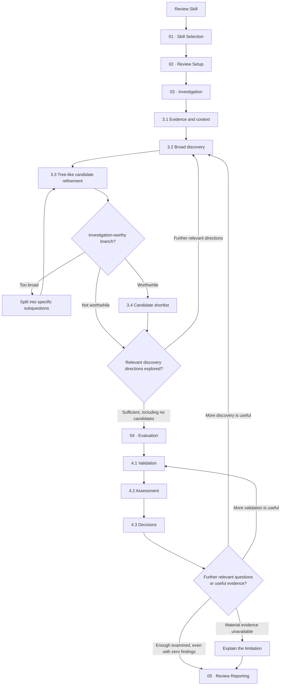

# Execute Eigenverft Review Skill Standard Migration

Migrate existing review skills into the Eigenverft review-skill structure. Create a **separate, usable migration candidate** for comparison and testing while keeping the original review skill intact. Apply the design contracts in the chapter references; preserve useful domain-specific methods and make intentional behavior changes visible.

## Target design

The target review skill separates five responsibilities. For finding-oriented reviews, the diagram illustrates **broad discovery, useful refinement of candidate questions, and deeper evaluation**. Continue exploring relevant parts of the scope after early findings, then report supported conclusions and meaningful limits. The five phases describe responsibilities rather than a rigid, one-way checklist.



Detailed responsibilities such as Identity, Scope, Review Basis, Findings, and Output Formatting are defined in the linked references. This diagram highlights the **investigation and evaluation flow**, not every design topic. Candidate refinement is a thinking aid; it does not require a written tree or queue. The output contract is established during Setup and applied during Reporting.

## Example: migrated review skill

The following is a **structural example**, not replacement text for the original review's specialized knowledge. Fill the placeholders using the original skill and the applicable chapter contracts.

```markdown
---
name: migrated-<original-skill-name>
description: Use only when explicitly invoked by the user for testing or comparing this migrated review skill.
---

# <Review Skill Title>

<Specific review purpose and central question.>

## 01 – Skill Selection
**Identity.** <Review identity and subject.>
**Applicability.** <When this kind of review is relevant; preserve its domain-specific limits.>

## 02 – Review Setup
**Request Resolution.** <User instructions, defaults, ambiguity.>
**Objective.** <What the review aims to learn.>
**Target / Scope.** <Subject and coverage boundaries.>
**Context / Revision.** <Relevant state.>
**Authority.** <Permitted actions and side-effect limits.>
**Evaluation Lens / Review Basis.** <Perspective and criteria.>
**Method Contract.** <Domain-specific investigation and evaluation approach.>

## 03 – Investigation
**Evidence.** <Reconstruct relevant context and inspect evidence.>
**Broad Discovery.** <Explore several meaningful investigation directions.>
**Tree-like Candidate Refinement.** <Split and filter broad leads into specific questions.>
**Candidate Shortlist.** <Retain investigation-worthy questions, not confirmed findings.>

## 04 – Evaluation
**Validation / Assessment / Decisions.** <Deeply evaluate candidates, counterevidence and practical significance.>
**Review breadth and depth.** <Continue investigating relevant directions after initial findings, including worthwhile Low-severity concerns after Critical/High/Medium results. Revisit questions that could change the assessment before reporting.>

## 05 – Review Reporting
<Selected outcome types, explicit format, detail, limitations and delivery.>
```

In the **temporary candidate**, the frontmatter `description` is intentionally restricted to explicit test/comparison use. Keep the review's substantive applicability in its instructions. When adopting a candidate as the productive skill, restore a meaningful normal activation description under the final name.

## Migration procedure

1. **Understand the original.** Resolve the selected review-skill package and permitted change scope. Read its complete `SKILL.md` and all behavior-changing references. Identify its real purpose, activation, scope behavior, permissions, investigation method, decisions, reporting contract, and any proven useful wording.
2. **Read the standard by chapter.** Read the five chapter indexes and applicable topic files, then map the original responsibilities to the target structure. For finding-oriented reviews, favor broad discovery, meaningful candidate refinement, and evidence-grounded evaluation. Encourage the agent to keep examining relevant concerns of any severity after early findings. Adapt the method to the actual review lens and preserve useful specialist techniques. Improve unclear defaults, conflicting instructions, and output contracts where the standard specifies them.
3. **Create a separate candidate.** By default, create `migrated-<original-skill-name>` as a distinct skill package alongside the original, using the test-only description shown above. Make the candidate complete enough to run independently, including necessary references. Do not rename, overwrite, or delete the original. If the user specifies another candidate path or naming scheme, follow it.
4. **Check the candidate.** Read its resulting files as a complete skill, validate the available package conventions, review links and behavior changes, and correct inconsistencies. Keep restructuring and intentional method/prompt changes distinguishable. Practical model comparisons can inform adoption; do not assume effectiveness from wording alone.
5. **Present the proposal.** Report the candidate path, major design decisions, relevant changes from the original, deliberate deviations, and verification status. Leave the original available for side-by-side testing and a separate decision on adoption. Do not commit or push unless authorized.

## Reference chapters

Each `README.md` is the index of its phase; its linked topic files define the specific migration contracts.

1. [01 · Skill Selection](references/skill-selection/README.md) — identity and applicability.
2. [02 · Review Setup](references/review-setup/README.md) — request resolution, objective, target, scope, context, authority, lens, basis, method.
3. [03 · Investigation](references/investigation/README.md) — evidence, broad discovery, tree-like refinement, and candidate shortlist.
4. [04 · Evaluation](references/evaluation/README.md) — validation, assessment, decisions, and useful returns to Investigation.
5. [05 · Review Reporting](references/review-reporting/README.md) — result selection, supported outcomes, limitations, output and delivery.

## Change boundaries

Work only within the authorized skill-migration scope. Preserve its domain-specific purpose, useful constraints, resources, scripts, and metadata unless the migration deliberately and legitimately changes them. Keep review recommendations separate from permission to implement them. Do not introduce mandatory sections for outcomes that do not apply; enforce explicit conventions such as the severity-rated findings table where relevant. Prefer actionable instructions over mechanical template completion.
