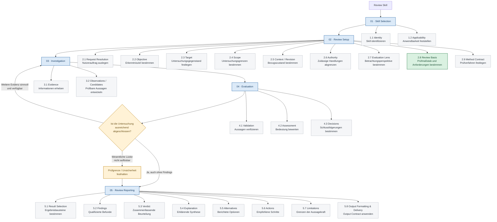
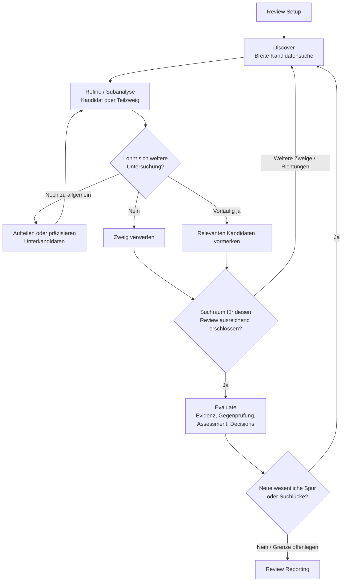

# Review-Skill-Workflow – mögliche Designgrundlage für zukünftige Skills

> **Status:** Arbeitsentwurf / Designgrundlage, keine verbindliche Repository-Regel
> **Stand:** 2026-10-29
> **Geltungsbereich:** Zukünftiger Entwurf und kritische Prüfung von Review-Skills
> **Nicht-Ziel:** Bereits existierende Skills automatisch angleichen oder einen universellen Pflichtablauf erzwingen

## Zweck

Dieses Dokument hält ein praxisbasiert entwickeltes **Meta-Modell für Review-Skills** fest. Es soll beim Entwurf neuer Skills helfen, wichtige Verantwortlichkeiten, Ablaufentscheidungen und Ergebnistypen nicht zu übersehen. Gleichzeitig ist es ein **Prüfraster**, um bestehende oder neue Review-Skills auf unklare Grenzen, fehlende Schritte und widersprüchliche Regeln zu untersuchen.

Das Modell ist **keine Vorlage, die jeder Skill vollständig abarbeiten muss**. Je nach Review-Art können einzelne Schritte entfallen, anders ausgestaltet oder zusammengelegt werden. Insbesondere müssen nicht alle Ergebnisbausteine erzeugt werden. Der tatsächliche Erkenntniszweck steht über formaler Vollständigkeit.

## Wie diese Grundlage entstanden ist

1. **Praxisinventar:** Die 21 vorhandenen `.agents/skills/review-*/SKILL.md`-Dateien wurden vollständig untersucht. Zunächst wurden wiederkehrende Begriffe, Verfahrensregeln und Ergebnisformate verglichen. Wo ein Output-Vertrag ausgelagert ist (beispielsweise bei `review-code-quality`), wurde diese Referenz in die Betrachtung einbezogen.
2. **Erster Kategorienbaum:** Die Anweisungen ließen sich zunächst in `Skill Definition`, `Review Instance`, `Review Execution` und `Review Result` gruppieren. Diese Sicht half, Meta-Objekte und Ergebnisarten zu erkennen.
3. **Negative Gegenprobe:** Es wurde geprüft, welche besonderen Regeln der vorhandenen Skills nicht sinnvoll in den Baum passen. Daraus entstand die Einsicht, dass **Vorkommenshäufigkeit kein Beweis für Wichtigkeit oder Vollständigkeit** ist: Die Skills können gemeinsame Designgewohnheiten teilen.
4. **Grenzprüfung der Begriffe:** Ein rein statischer Kategorienbaum wurde in einen zeitlichen Workflow überführt. Dabei wurden problematische Gleichsetzungen aufgelöst: `Applicability` ist nicht `Request Resolution`; `Authority` ist nicht `Output Delivery`; `Verdict` ist nicht `Explanation`; ein `Output Contract` ist nicht das tatsächlich erzeugte Ergebnis.
5. **Externe Gegenprobe:** Ein zusätzliches Research zu Code-, Security-, Architektur- und Paper-Reviews wurde kritisch mit der Repository-Praxis verglichen. Nicht jede externe Methode wurde übernommen. Als hinreichend bedeutsam blieben zwei Anpassungen: **`Review Basis` als eigenständiger Prüfmaßstab** und **ein Rücksprung von Evaluation zu Investigation**, wenn eine Erkenntnis zusätzliche Evidenz benötigt.

Die bisherige Fassung wird für die geplante praktische Gegenprobe im Folgenden als **V1** bezeichnet. Die neue, darauf aufbauende **V2** steht am Ende des Dokuments. Diese Versionsnamen dienen dem Vergleich; beide Ansätze bleiben **Arbeitshypothesen**, keine verbindlichen Regeln. Die Entstehungsgeschichte der ursprünglich als „Arbeitsstand v2“ bezeichneten Fassung bleibt unverändert.

## V1 – Bisheriger Review-Skill-Workflow

Die Nummerierung markiert die **primäre zeitliche Nutzung**. Sie bedeutet nicht, dass eine Regel erst in ihrer Phase bekannt wird oder nur dort gilt. Die Ergebnisbausteine in Phase 05 sind **mögliche Inhalte, keine zwingend vollständig abzuarbeitende Sequenz**.



## Bedeutung der fünf Phasen

| Phase | Primäre Funktion | Abgrenzung |
| --- | --- | --- |
| **01 – Skill Selection** | Den passenden Skill anhand von Identität und Anwendbarkeit auswählen. | Noch nicht das Review selbst ausführen. |
| **02 – Review Setup** | Die konkrete Anfrage auslegen und Ziel, Gegenstand, Grenzen, Bezugszustand, Befugnisse, Perspektive, Prüfmaßstab und Vorgehen bestimmen. | Keine Findings vorwegnehmen und keine unbewiesenen Anforderungen erfinden. |
| **03 – Investigation** | Relevante Informationen erheben, verstehen und daraus prüfbare Beobachtungen oder Kandidaten bilden. | Kandidaten nicht als bestätigte Findings behandeln. |
| **04 – Evaluation** | Aussagen validieren, ihre Bedeutung bewerten und fachliche Entscheidungen treffen; bei Bedarf zurück zu Investigation. | Weder unbelegte Befunde bestätigen noch eine nicht abschließbare Prüfung als erfolgreich abgeschlossen ausgeben. |
| **05 – Review Reporting** | Die für diesen Review erforderlichen Ergebnisbausteine bestimmen und gemäß Output Contract ausgeben. | Keine Empfehlung automatisch umsetzen; nicht alle dargestellten Bausteine erzwingen. |

## Begriffsgrenzen (Boundaries)

| Begriff | Bedeutet | Ist nicht |
| --- | --- | --- |
| **Identity** | Erkennbarer Skill-Name und seine Beschreibung. | Der konkrete Review-Auftrag. |
| **Applicability** | Ob und wann ein Skill verwendet werden soll. | Die Auslegung von Nutzerzusätzen nach der Auswahl. |
| **Request Resolution** | Den aktuellen Auftrag einschließlich Gesprächskontext, Nutzerwünschen, Modi und relevanter Unklarheiten interpretieren. | Ein unbestimmter Resttopf für Target, Scope, Authority oder Output. |
| **Objective** | Welche Erkenntnis oder Beurteilung erreicht werden soll. | Der untersuchte Gegenstand oder der Bewertungsmaßstab. |
| **Target** | Das konkret untersuchte Objekt, beispielsweise ein Modul oder ein Diff. | Die Grenzen der Untersuchung. |
| **Scope** | Welche Bereiche und Fragen im Review liegen und welche ausgeschlossen sind. | Automatisch eine harte Grenze für sämtliche Belegquellen. |
| **Context / Revision** | Auf welchen fachlichen, technischen oder zeitlichen Zustand sich das Urteil bezieht. | Die Fragestellung selbst. |
| **Authority** | Welche Untersuchungsaktionen, Zugriffe und Seiteneffekte erlaubt sind. | Berichtsaufbau, Format oder Ausgabekanal. |
| **Evaluation Lens** | Unter welchem Gesichtspunkt das Target betrachtet wird, beispielsweise Sicherheit oder Änderbarkeit. | Die konkrete Norm, gegen die geprüft wird. |
| **Review Basis** | Anforderungen, Spezifikationen, Regeln, Invarianten oder Sollzustände als Maßstab. | Ein stillschweigend erfundener Wunschzustand. Fehlt die Basis, muss das angemessen berücksichtigt werden. |
| **Method Contract** | Welche Prüfverfahren und Schritte gelten, beispielsweise Source-first oder gezielte Gegenprüfung. | Eine Berechtigung, gesperrte Aktionen trotzdem auszuführen. |
| **Evidence** | Tatsächlich verfügbare und relevante Informationen. | Bereits eine bestätigte Schlussfolgerung. |
| **Observations / Candidates** | Beobachtete Auffälligkeiten und daraus entwickelte prüfbare Hypothesen. | Qualifizierte, veröffentlichungsreife Findings. |
| **Validation** | Ob eine Behauptung durch ausreichende Evidenz gestützt ist. | Bewertung von Tragweite, Nutzen oder Priorität. |
| **Assessment** | Bedeutung, Auswirkung oder Qualität eines ausreichend verstandenen Sachverhalts beurteilen. | Entscheidung über die endgültige Darstellung. |
| **Decisions** | Kandidaten oder Deutungen bestätigen, verwerfen, offenlassen und gegebenenfalls priorisieren. | Formatierung des Ergebnisberichts. |
| **Result Selection** | Bestimmen, welche Ergebnisarten nach Review-Typ und konkretem Ausgang erforderlich und zulässig sind. | Erzwingen aller optionalen Ergebnisarten. |
| **Findings** | Qualifizierte, berichtsfähige Befunde. | Jegliche ungeprüfte Beobachtung. |
| **Verdict** | Zusammenfassende Beurteilung. | Eine reine Erklärung der Designabsicht. |
| **Explanation** | Begründete Erläuterung von Bedeutung, Funktionsweise oder Designrationale. | Zwingend ein Qualitätsurteil. |
| **Alternatives** | Bewertete und berichtete Lösungs- oder Deutungsoptionen. | Sämtliche intern erwogenen und verworfenen Ideen. |
| **Actions** | Konkrete empfohlene nächste Schritte. | Deren automatische Umsetzung. |
| **Limitations** | Wesentliche Grenzen der Aussagekraft, ungeklärte Punkte oder nicht verfügbare Belege. | Eine beliebige Vollständigkeitsfloskel. |
| **Output Formatting & Delivery** | Die ausgewählten Ergebnisse gemäß Output Contract darstellen und ausliefern. | Definition oder Erhebung der fachlichen Erkenntnisse. |

### Output Contract: übergreifende Regel, nicht erst am Ende bekannt

Ein **Output Contract** kann Inhaltsanforderungen, Pflichtfelder, Struktur, Reihenfolge, bedingte Ausgabeformen (etwa bei null Findings), Sprache, Ausgabeformat und Lieferkanal festlegen. Er ist **nicht gleichbedeutend mit `Output Structure`** und auch **nicht identisch mit dem fertigen `Review Result`**.

Seine Regeln sind bereits bei der Vorbereitung bekannt, damit die Untersuchung notwendige Informationen erheben kann. **In 5.8 werden sie auf die tatsächliche Ausgabe angewendet und kontrolliert.** Die Position in Phase 05 zeigt somit den Anwendungsschwerpunkt, nicht den Entstehungszeitpunkt.

Die Unterscheidung gilt auch für andere Verträge: `Authority` wird im Setup geklärt, gilt aber während der gesamten Ausführung. `Method Contract` wird im Setup bestimmt und in Investigation und Evaluation eingehalten.

**Abgrenzungsbeispiele:**

- `read-only; keine Dateien oder Git-Zustände verändern` → **Authority**.
- `Ergebnis ausschließlich im Chat ausgeben` → **Output Contract / Delivery**.
- `Nutzer wünscht statt der Standardtabelle eine kompakte Liste` → **Request Resolution** (Wunsch verstehen) und **Output Contract** (zulässige Ausgabe anwenden).
- `Nur bei explizitem Review-Auftrag aktivieren` → **Applicability**.
- `Keine unbestätigte Hypothese als bestätigten Befund berichten` → **Validation / Decisions**, anschließend **Output Contract**.

## Iteration, Unsicherheit und Abschluss

Der Rückweg **Evaluation → Investigation** ist entscheidend: Eine Prüfung kann weitere Quellen, zusätzliche Kontextanalyse oder die Gegenprüfung einer Hypothese erforderlich machen. Die Schleife ist **kein Zwang zu endloser Suche**.

Für den Übergang zu Reporting werden drei Fälle unterschieden:

1. **Ausreichend abgeschlossen:** Die Untersuchung ist für ihren Zweck hinreichend belastbar – ausdrücklich auch dann, wenn es **keine Findings** gibt.
2. **Weitere Evidenz sinnvoll und verfügbar:** Gezielte Nachuntersuchung statt vorschneller Bewertung.
3. **Wesentliche Evidenz nicht verfügbar:** Unsicherheit beziehungsweise Prüfgrenze festhalten und das Ergebnis nur mit zutreffender Einschränkung berichten. Ein eingeschränkter Review darf nicht als unbeschränkt abgeschlossen dargestellt werden.

Ein fehlender Befund ist also **nicht automatisch** eine vollständig durchgeführte, uneingeschränkt positive Prüfung.

### Early Exit Prevention Gate – Reviewtiefe und Schutz vor vorzeitigem Abschluss

**Problem:** Ein Modell kann einen Review schon nach den ersten plausiblen oder gut validierten Findings für erledigt halten. Dadurch bleiben weitere relevante Untersuchungsrichtungen unberücksichtigt. Besonders bei schwächeren Modellen kann eine bloß allgemein formulierte Aufforderung zur Gründlichkeit dafür zu wenig sein. Außerdem können bereits gefundene Critical-, High- oder Medium-Probleme kleinere, aber dennoch berechtigte Low-Severity-Befunde aus der weiteren Suche verdrängen.

**Designbaustein:** Ein **Early Exit Prevention Gate** macht ausdrücklich klar, dass weder eine Anzahl gefundener Findings noch deren Schweregrad den Abschluss rechtfertigt. Es setzt einen zur Review-Aufgabe passenden **intensiven Prüfungsanspruch** und fordert vor dem Reporting einen **kritischen Selbstreview** der noch offenen Untersuchungsrichtungen. Bei materiellen, sinnvoll aufklärbaren Lücken muss die Untersuchung gezielt in Investigation und/oder Evaluation fortgesetzt werden. Das Gate ist eine **phasenübergreifende Regel**, keine weitere Pflichtphase und kein Ersatz für den V1-Ablauf oder die V2-Kandidatenverfeinerung.

Das Gate verbindet vier Aufgaben:

1. **Reviewtiefe:** Den relevanten Scope mit einer dem Ziel angemessenen Intensität untersuchen; nicht lediglich die ersten erkannten Auffälligkeiten ausarbeiten.
2. **Kein Finding-basierter Early Exit:** Erste, mehrere oder besonders schwerwiegende Findings beenden die Suche nicht. Insbesondere dürfen High-/Medium-Findings die Prüfung anderer relevanter, auch niedriger priorisierter Aspekte nicht verdrängen.
3. **Completion Self-Review:** Vor dem Reporting überprüfen, ob wesentliche Bereiche, andere plausible Kandidaten, Gegenbelege oder noch beantwortbare Fragen übersehen wurden. Materielle Lücken gezielt nachuntersuchen und erneut bewerten.
4. **Saubere Abschlussgrenze:** Erst bei hinreichend tragfähiger Untersuchung abschließen; fehlende Evidenz und Prüfgrenzen ehrlich angeben. Keine Mindestzahl an Findings, keine Pflicht zu Low-Findings, keine künstliche Eskalation und keine endlose oder unautorisierte Scope-Ausweitung.

**Einordnung im Workflow:** Der Anspruch kann im **Review Setup / Method Contract** festgelegt werden, steuert die tatsächliche Arbeit in **Investigation und Evaluation** und wird beim Übergang zu **Review Reporting** geprüft. Die fachlichen Prüfmaßstäbe, Autorisierung und der Output Contract bleiben eigenständig. Das Gate verlangt keine veröffentlichte Zwischenliste und keine formale Laufzeitsperre; seine Wirkung ist eine zu testende Anweisungswirkung.

**Konkretes, bisher erfolgreich erprobtes Beispiel** für `review-abstraction-and-responsibility-boundaries`, unverändert aus der aktuellen V2-Phase 03 (inklusive Erweiterung für Low-Severity-Findings):

```text
**Review depth and completion self-review.** Conduct discovery and evaluation with the depth expected from a **very intensive responsibility-boundary review** of the selected scope. Finding one or several plausible candidates or validated findings is **not a stopping condition**: continue investigating other relevant responsibility boundaries and evaluating material questions while further targeted inspection may change the conclusions. Multiple Critical, High, or Medium findings must not crowd out continued investigation of relevant Low-severity concerns; severity is not a search filter or completion criterion, and no severity level needs to be populated artificially. Before reporting, critically self-review whether important in-scope responsibilities, ownership of state and rules, access paths, ordinary change scenarios, or credible counterarguments were overlooked; return to discovery/refinement or evaluation to close material, answerable gaps. Stop only when further relevant investigation is unlikely to change the assessment, or disclose concrete evidence limitations. Do not invent findings or expand beyond the authorized scope.
```

Das Beispiel ist **domänenspezifisch** und als Ausgangspunkt für weitere isolierte Tests gedacht, nicht als wörtliche Pflichtformulierung für jeden Review-Skill. Ob Intensitätsanspruch, Nichtabbruch-Regel, Severity-Unabhängigkeit oder Selbstreview jeweils notwendig sind, und wie stark sie bei unterschiedlichen Modellen wirken, bleibt weiter zu prüfen.

## Anwendung als Prüfraster für künftige Skills

Beim Entwurf eines neuen Review-Skills sollte geprüft werden:

- Ist klar, **wann** der Skill gewählt wird und **wie** Nutzerzusätze sowie bestehender Gesprächskontext behandelt werden?
- Sind **Objective**, **Target**, **Scope**, **Context**, **Authority**, **Lens** und gegebenenfalls **Review Basis** voneinander unterscheidbar?
- Sind die geltenden **Prüfmethoden** ausreichend beschrieben, ohne Berechtigungen oder Seiteneffekte implizit zu erweitern?
- Trennt der Skill **Beobachtungen**, **Validierung**, **Bewertung** und **Entscheidungen** soweit nötig?
- Können **Gegenbelege**, **fehlende Informationen** und **Nachuntersuchung** das Ergebnis tatsächlich beeinflussen?
- Ist bei intensiven Finding-orientierten Reviews ein **Early Exit Prevention Gate** sinnvoll, damit frühe oder höher priorisierte Findings die Untersuchung anderer relevanter Aspekte nicht vorzeitig beenden?
- Kann ein Review **ohne Findings** abgeschlossen werden? Was geschieht, wenn er **nicht abschließend prüfbar** ist?
- Sind die **erforderlichen Ergebnistypen** ausgewählt, statt Findings, Verdict, Alternatives und Actions pauschal zu erzwingen?
- Regelt der **Output Contract** nicht nur das Markdown-Layout, sondern bei Bedarf auch Inhalt, Bedingungen und Delivery?
- Sind **Empfehlungen** eindeutig von einer gesondert zu autorisierenden **Umsetzung** getrennt?

Das Raster ist **diagnostisch**, nicht mechanisch. Ein nicht einschlägiger Punkt ist kein Designfehler. Spezielle Review-Typen dürfen eigene Verfahren und Ergebnisse besitzen.

## Bewusste Grenzen und offene Fragen

- **Kein universeller Finding-Zwang:** Erklärende oder vergleichende Reviews produzieren möglicherweise primär Explanations, Alternatives oder Verdicts.
- **Keine erzwungene Phasenlinearität:** Die Hauptreihenfolge ist ein verständliches Standardmodell; einzelne Untersuchungsschritte dürfen bei Bedarf iterieren oder erneut aufgesetzt werden.
- **Keine automatische Berechtigung:** Eine Methodenvorgabe wie „Test ausführen“ hebt eine bestehende Authority-Grenze nicht auf.
- **Review Basis ist kontextabhängig:** Nicht jeder Review besitzt eine formelle externe Spezifikation; der Prüfmaßstab muss gegebenenfalls aus tatsächlich belegten Invarianten oder Designzielen ermittelt werden.
- **Output Contract ist ein phasenübergreifender Vertrag:** Die Abbildung in Phase 05 ist bewusst eine Workflow-Sicht.
- **Weitere Prüfung sinnvoll:** Insbesondere die Grenze zwischen `Applicability` und `Request Resolution` sowie zwischen `Evaluation Lens` und `Review Basis` sollte an zukünftigen realen Skill-Entwürfen überprüft werden.
- **Keine verpflichtende Migration:** Dieses Dokument ändert weder vorhandene `SKILL.md`-Dateien noch gilt es automatisch als neue Ausführungsanweisung.

## Herkunft und nächste Verwendung

**Interne empirische Grundlage:** 21 bestehende Review-Skills unter `.agents/skills/review-*/SKILL.md`; deren Methoden und Ergebnisverträge wurden auf wiederkehrende Funktionen und Gegenbeispiele geprüft.

**Externe Gegenprobe:** Vom Nutzer bereitgestellte Recherche zu Review-Prozessen, unter anderem Code-Review, Security-Audit, Architektur- und Paper-Review. Die recherchierten Modelle wurden nicht unkritisch übernommen; sie dienten als Hypothesentest für möglicherweise fehlende Aspekte.

**Empfohlene Weiterverwendung:** Bei zukünftigen neuen Review-Skills das Modell als **Design-Checkliste und Diskussionsgrundlage** verwenden, Abweichungen begründen und anhand praktischer Skills weiterentwickeln. Änderungen am Modell sollten eine konkrete zusätzliche Verantwortung, einen relevanten Fehlerfall oder eine bessere Begriffsgrenze erklären können – nicht allein eine weitere Überschrift erzeugen.

## V2 – Experimenteller Workflow mit Kandidatenbaum

> **Status:** Alternative Arbeitshypothese für einen Praxistest, nicht als überlegen bestätigt und keine neue Skill-Konvention.
> **Bezug zu V1:** Skill Selection, Review Setup, Authority, Review Basis, Output Contract und Reporting bleiben grundsätzlich erhalten. V2 verändert vor allem, **wie vor der eigentlichen Evaluation Kandidaten entdeckt und präzisiert werden**.

### Ausgangsproblem und Hypothese

Bei Reviews können Modelle nach den ersten plausiblen Beobachtungen zu früh in die gründliche Prüfung und Berichterstattung wechseln. Dann sind einzelne Findings möglicherweise gut validiert, während andere relevante Untersuchungsrichtungen nie ernsthaft betrachtet wurden. Ein Rücksprung von Evaluation zu Investigation löst das nicht zuverlässig, wenn das Modell seine bisherige Untersuchung schon für ausreichend hält.

**V2-Hypothese:** Eine zunächst breite, anschließend baumartig verfeinerte Kandidatensuche trennt die **Suche nach lohnenden Fragen** von der **späteren Prüfung ihrer tatsächlichen Gültigkeit**. Das könnte sowohl blinde Flecken als auch vorschnelle Festlegung reduzieren. Ob das in der Praxis tatsächlich besser funktioniert, ist offen.

### Ablaufidee: erst Kandidatenraum, danach wirkliche Evaluation

1. **Discover – mögliche Kandidaten sammeln.** Den relevanten Gegenstand aus mehreren sinnvollen Richtungen betrachten und zunächst potenzielle Auffälligkeiten, Risiken oder Fragen notieren. Nicht die erste plausible Spur direkt zum endgültigen Hauptbefund machen.
2. **Refine / Subanalyse – Kandidaten auffächern und filtern.** Für einen Kandidaten kurz fragen: Welche spezifischeren Teilfragen stecken darin? Welche Zweige sind für den Review relevant, welche offenbar nicht, welche müssen noch präzisiert werden? Relevanz meint hier nur **Untersuchungswürdigkeit**, nicht bestätigte Richtigkeit.
3. **Kandidatenbestand bilden.** Nur die verbleibenden lohnenden, hinreichend konkreten Untersuchungsfragen für die eigentliche Prüfung behalten. Ein übergeordneter Kandidat kann vollständig entfallen, obwohl ein einzelner Unterkandidat relevant bleibt. Der Bestand enthält **weiterhin ausschließlich Kandidaten, keine Findings**.
4. **Evaluate – erst jetzt gründlich prüfen.** Den verbleibenden Kandidaten gezielt Evidenz und Gegenbelege gegenüberstellen, Aussagen validieren, Bedeutung einschätzen und entscheiden, was bestätigt, widerlegt oder ungeklärt bleibt.
5. **Coverage und Abschluss prüfen.** Sind die wesentlichen Suchrichtungen für Objective, Scope und verfügbaren Aufwand angemessen betrachtet? Sind relevante Kandidaten ausreichend geprüft? Falls Evaluation neue lohnende Zweige oder eine wesentliche Suchlücke sichtbar macht, gezielt zu Discover/Refine zurückkehren. Andernfalls die qualifizierten Ergebnisse gemäß Output Contract berichten, auch mit null Findings oder ausgewiesenen Grenzen.



**Gedankenbeispiel:** Der Ausgangskandidat „Modulstruktur problematisch“ zerfällt in „fachliche Modulgrenzen“ und „gemeinsam verantworteter Datenlebenszyklus“. Der erste Zweig kann als unauffällig oder nicht lohnend ausscheiden, während der zweite als präziser Kandidat überlebt. Der ursprüngliche Pauschalkandidat braucht dann nicht zusätzlich erhalten zu bleiben. Ob der verbliebene Zweig wirklich ein Problem ist, wird **erst in Evaluate** geklärt.

### Leichtgewichtig statt wortprogrammierter Datenstruktur

- **Baum als Denkmodell, nicht als Pflichtartefakt:** Weder ein ausgeschriebener Baum noch eine persistierte Queue, feste Tiefe oder formale Knotenstatus sind erforderlich. Ein kurzer interner Kandidatenbestand genügt, wenn er die Untersuchung trägt.
- **Breite vor vorschneller Tiefe:** Eine anfängliche Suche soll mehrere sinnvolle Richtungen erschließen. Das aus anderen praktischen Skills bekannte **weiche Suchziel von ungefähr fünf** kann als experimentelle Orientierung dienen, aber weder fünf Ideen noch fünf überlebende Kandidaten erzwingen. Es ist kein Qualitätsnachweis.
- **Kleine Relevanzprüfung ist noch keine Validation:** In Refine darf mit vorhandenem Kontext grob eingegrenzt, aufgeteilt oder eine klar unpassende Spur verworfen werden; anspruchsvolle Tatsachenbehauptungen werden dadurch nicht als geprüft behandelt. Relevante Unsicherheit ist ein Grund zum Behalten oder gezielten Klären, nicht zum Wegfiltern.
- **Keine künstliche Vollständigkeit:** Neue Unterzweige entstehen nur, wenn sie echte unterschiedliche Fragen sichtbar machen. Fehlende Evidenz darf nicht durch erfundene Kandidaten ersetzt werden; ebenso wenig soll endlos weitergesucht werden.
- **Abschluss nach Aussagekraft, nicht Queue-Leere:** Ein abgearbeiteter Kandidatenbestand beweist keine ausreichende Abdeckung. Umgekehrt darf ein Review bei verhältnismäßig erschlossenem Suchraum, ausreichender Prüfung und transparenten Grenzen enden.
- **Keine Änderung der Befugnisse:** Discovery, Subanalyse und Evaluation bleiben innerhalb des jeweiligen Scope, der Authority und der bestehenden Sicherheitsgrenzen; aus einem Kandidaten folgt keine Erlaubnis zur Umsetzung.

### Praktische Gegenprobe: V1 gegen V2

V2 wird nicht allein aufgrund des Entwurfs als Standard übernommen. Als erste Grundlage wurde `review-abstraction-and-responsibility-boundaries` gewählt; zwei methodisch vergleichbare Fassungen liegen unter `todo/review-skill-future-designs/experiments/review-abstraction-and-responsibility-boundaries/` (V1 und V2). Der Vergleich soll sich am tatsächlichen Review-Verhalten orientieren:

1. Einen fachlich geeigneten Review-Skill auswählen und **zwei experimentelle Varianten** auf derselben Ausgangsbasis herstellen: eine nach V1, eine nach V2. Ziel, fachliche Review-Lens, Authority und wesentliche Ergebnisanforderungen möglichst konstant halten. Die aktive Originalfassung nicht stillschweigend ersetzen.
2. Beide Varianten an **denselben realistischen Review-Aufgaben und demselben Repository-/Revisionsstand** erproben; die Durchläufe möglichst unabhängig halten, damit die Ergebnisse sich nicht gegenseitig vorprägen.
3. **Tatsächliche Unterschiede** anhand konkreter Evidenz vergleichen: entdeckte Untersuchungsrichtungen, übersehene relevante Bereiche, Tiefe der Kandidatenprüfung, belastbare und falsche Findings, Umgang mit Unsicherheit, praktischer Erkenntniswert und Aufwand. Weder Kandidatenzahl noch Berichtslänge allein als Erfolg werten.
4. Auch Gegenbeispiele erfassen: Wo bringt V2 mehr Breite und bessere Befunde, wo erzeugt es unnötige Kandidaten, Mehraufwand oder sogar schlechtere Entscheidungen? Wo ist V1 mindestens gleich gut?
5. Erst aus dem **beobachteten Verhalten** entscheiden, ob V2 übernommen, vereinfacht, verändert oder verworfen werden sollte.

### Vorläufige Beobachtung aus den Praxistests (2026-10-29)

- **Schwächere Modelle (vor dem Early Exit Prevention Gate):** Laut damaliger praktischer Erprobung des Nutzers zeigten die beiden Skill-Fassungen **keinen nennenswerten Unterschied** im Ergebnis; ein Mehrwert von V2 gegenüber V1 war dabei nicht erkennbar.
- **Leistungsfähigere Modelle:** In der bisherigen praktischen Erprobung des Nutzers schnitt **V2 leicht besser als V1** ab. Der beobachtete Vorteil ist klein; welche konkreten Unterschiede ihn ausmachen, ist hier noch nicht dokumentiert.
- **Einordnung:** Dies ist ein qualitatives Zwischenfazit, keine abgeschlossene oder quantifizierte Gegenprobe. Modellbezeichnungen, Testfälle, Einzelresultate und Messwerte sind hier noch nicht dokumentiert. Der leicht bessere Eindruck bei leistungsfähigeren Modellen ist kein Nachweis eines allgemeinen oder messbar großen V2-Vorteils.

Die beiden Entwürfe bleiben für die weitere Erprobung erhalten; über eine Übernahme wird erst anhand der praktischen Unterschiede entschieden.

### Praxistest: Early Exit Prevention Gate (2026-10-29)

**Beobachtete Testfolge beim schwächeren Modell:** Die früheren Durchläufe berichteten jeweils **zwei Findings**, auch nach einer umfangreicheren, später zurückgenommenen Investigation-Nachschärfung. Mit der isolierten Intensitäts-/Nichtabbruch-Regel in V2 (`6c10fb7`) berichtete das Modell **drei Findings**, die nach Einschätzung des Nutzers ungefähr den Findings des leistungsfähigeren Modells entsprachen. Nach der ebenfalls isolierten Ergänzung gegen Severity-bedingten Early Exit (`8f2ca36`) lieferte das schwächere Modell **alle vier Findings des besten High-Modells: drei Medium und ein Low**. Das ist ein deutlich positives praktisches Vergleichsergebnis, aber keine kontrollierte Ursachenmessung. Insbesondere ist noch nicht nachgewiesen, dass der vierte Befund ausschließlich auf die neue Severity-Formulierung zurückgeht.

**Abstraktes Wirkprinzip – Early Exit Prevention Gate:** Ein Review soll Discovery und Evaluation mit der für den gewählten Scope angemessenen **Tiefe eines sehr intensiven Reviews** fortführen. Bereits gefundene plausible oder validierte Findings sind **kein Abschlusskriterium**. Vor dem Übergang zum Reporting prüft das Modell kritisch, ob relevante Untersuchungsrichtungen, Kandidaten, Gegenbelege oder noch sinnvoll überprüfbare Fragen übergangen wurden, und setzt Discovery beziehungsweise Evaluation bei wesentlichen Lücken gezielt fort. Der Abschluss hängt von der **hinreichenden Untersuchung**, nicht von einer Mindest- oder Höchstzahl an Findings ab. Scope, Evidenzanforderungen und die Möglichkeit von null Findings bleiben erhalten.

Das **Early Exit Prevention Gate** wird oben deshalb als eigenständiger, bereits praktisch erfolgreich erprobter **Designbaustein mit aktuellem konkretem Beispiel** dokumentiert. Es ist noch keine universell validierte Pflichtregel: Weitere isolierte Varianten, Wiederholungen und andere Review-Arten sollen zeigen, welcher Mechanismus wie zuverlässig wirkt. Das allgemeine V1/V2-Grunddesign bleibt davon getrennt.
